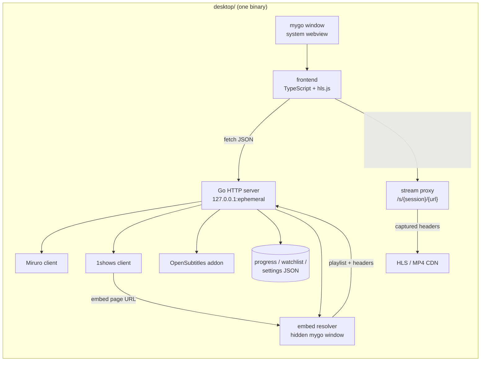
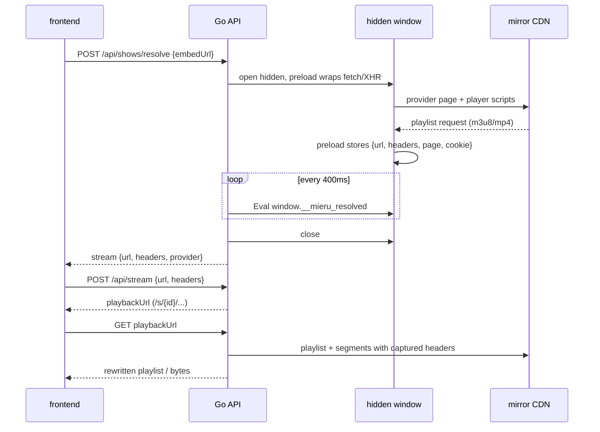
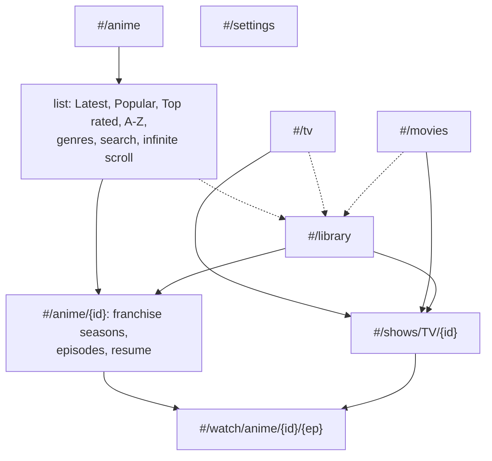

# Mieru Desktop: design

Goal: the Android app's behaviour on macOS and Windows, in the same repo, under
`desktop/`. Anime comes from Miruro, TV and movies from 1shows, and all playback
is a real `<video>` element. No provider page is ever shown.

## Shape

The webview loads the app from `http://127.0.0.1:<port>/`, which Go serves from
the embedded `dist/`. That makes the page same-origin with the API and the media
proxy, so there is no CORS anywhere, and the whole UI can be opened in a normal
browser for verification.

## Resolving an embed

The Android app loads the mirror in a 2x2 WebView and watches its traffic. The
desktop app does the same thing with a hidden mygo window.

`streamproxy` serves playlists with every URI rewritten back through itself, and
segments with Range passthrough. It also unwraps provider wrapper URLs that carry
their real target and headers in the query (`host=` + `headers=`).

## Routes

## API

| Method | Path | Purpose |
|---|---|---|
| GET | `/api/bootstrap` | settings, sources, watchlist, continue-watching, version |
| GET | `/api/anime?sort&q&genres&cursor&limit` | catalogue page |
| GET | `/api/anime/latest` | recently aired, one row per show |
| GET | `/api/anime/{id}/show` | franchise seasons |
| GET | `/api/anime/{id}/episodes` | episode list |
| GET | `/api/anime/{id}/play/{ep}` | sources for an episode |
| GET | `/api/shows/trending?kind=TV\|MOVIE` | trending grid |
| GET | `/api/shows/search?q` | search |
| GET | `/api/shows/detail?kind&id` | detail |
| GET | `/api/shows/season?kind&id&season` | episode list |
| GET | `/api/shows/mirrors?kind&id&season&ep` | embed mirrors |
| POST | `/api/shows/resolve` | hidden-window resolve, cached 20 min |
| GET | `/api/subtitles?imdb&season&episode` | side-loaded tracks |
| POST | `/api/stream` | open a proxy session |
| GET | `/s/{session}/{url}` | playlist, segment, mp4 |
| POST | `/api/progress` | record watch time |
| POST | `/api/watchlist/toggle` | save or remove |
| PUT | `/api/settings` | sources, site, track, auto-skip, subtitle style |

## Storage

One JSON file each, in the OS config directory under `Mieru Desktop/`:
`progress.json`, `watchlist.json`, `settings.json`. Writes are atomic and
serialised by a mutex, the same contract as `ProgressStore` and `WatchlistStore`
on Android.

## Ported rules

- Miruro payloads are `gzip(xor(bytes, "miruro/catalog"))`.
- Request headers derive from the configured Miruro base (`Sec-Fetch-Site`,
  `Referer`), which is what makes mirrors work.
- 1shows requests carry `Referer: <site>/` and `Accept: application/json`.
- Stream picker order: sub/ssub before dub, providers in preference order, and
  `Origin` derived from the stream `Referer`.
- Episode release rule: dated rows count as released on or before today; an
  undated row counts only when a later row has aired; no dates at all means all
  released.
- Specials (`kind != regular`) are dropped unless nothing else exists.
- Continue watching hides anything 95% finished; recents only move forward.
- Progress keys: `id:0:episode` for anime, `id:season:episode` otherwise.

## Verification

- `go test ./...` with live tests for both catalogues and a resolver test that
  resolves a real mirror and fetches the playlist through the proxy.
- The page is exercised in a browser against the running server (Playwright),
  which is the same code the webview runs.
- `mygo build -platform darwin/universal,windows/amd64,windows/arm64` produces
  the app bundles. macOS is launched and screenshotted; Windows is
  cross-compiled, since this machine has no Windows host.
