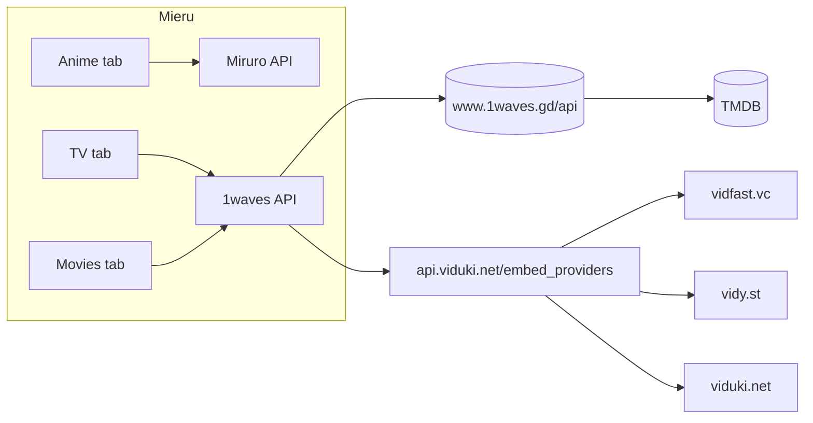
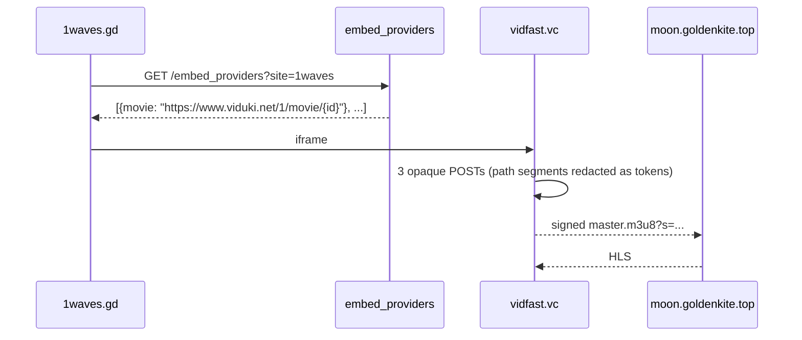
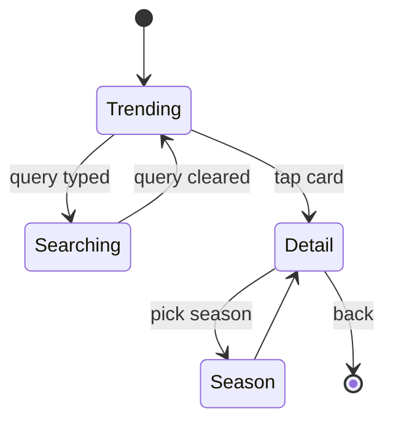

# TV shows and movies via 1waves.gd

Date: 2026-11-19
Status: proposed, PR 1 of 2

## Why

Mieru only knows Miruro. 1waves.gd is a second catalogue with TV and movies. The app grows from
one list into three sections without touching the anime path.

## What 1waves actually is

It is a Next.js site over TMDB metadata, with playback delegated to third-party embeds.



| Concern | Endpoint | Notes |
|---|---|---|
| Trending TV | `db.1waves.gd/api/management/trending/tv` | ids only, needs hydration |
| Trending movies | `db.1waves.gd/api/management/trending/movies` | ids only |
| Search | `www.1waves.gd/api/search/query?query=` | TMDB result shape, has `media_type` |
| TV detail | `www.1waves.gd/api/tv/{id}` | `seasons[]`, `number_of_seasons` |
| Season | `www.1waves.gd/api/tv/{id}/season/{n}` | `episodes[]` |
| Episode | `www.1waves.gd/api/tv/{id}/season/{n}/episode/{e}` | metadata only, no stream |
| Movie detail | `www.1waves.gd/api/movie/{id}` | |
| Providers | `api.viduki.net/embed_providers?site=1waves` | URL templates per provider |

Every request needs `Referer: https://www.1waves.gd/`. Without it `/api/tv/*` answers
`403 Forbidden: Not Allowed Gang`. Same shape as the Miruro edge rule, so `SourceStore` already
models this.

## Where playback stands

Playback is not in the metadata API. The site builds an iframe per provider:



Observed: `vidfast.vc` does produce a direct signed master playlist, but only after three
tokenised POSTs its own JS performs. `viduki.net` gates with an Altcha captcha, which a native
client cannot pass. Reproducing each provider is per-provider reverse engineering, the same class
of work as the Anikoto Aes step, not a metadata call.

So this PR ships **browse and detail** for TV and movies. Playback needs its own PR against a
`PlaybackResolver` seam. The detail screen says so instead of offering a dead button.

## Data model

One shape for three sections, so the UI does not branch on section:

```kotlin
enum class MediaKind { ANIME, TV, MOVIE }

data class MediaCard(id, kind, title, posterUrl, year, score)
data class MediaDetail(id, kind, title, overview, posterUrl, backdropUrl, year, score,
                       genres: List<String>, seasons: List<SeasonInfo>, runtimeMinutes: Int?)
data class SeasonInfo(number, name, episodeCount)
data class MediaEpisode(number, title, overview, stillUrl, airDate, runtimeMinutes)
```

`principle-model-the-domain` drove this: the alternative was reusing `Anime`, `Episode` and
`SeasonRow` with nullable fields for TMDB data, which leaks two schemas through every composable.
A small shared model keeps the anime path untouched and gives TV/movies their own screens.

## Flow



## Out of scope

- Playback resolution for 1waves providers (PR 2).
- Trackers, downloads, library. Unchanged.
